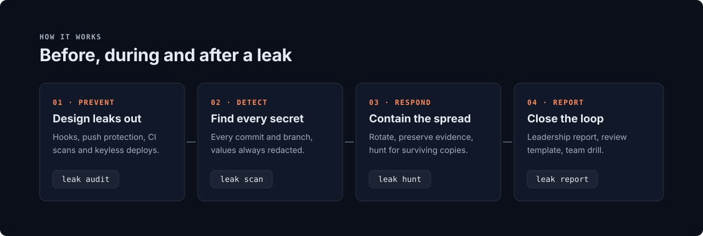
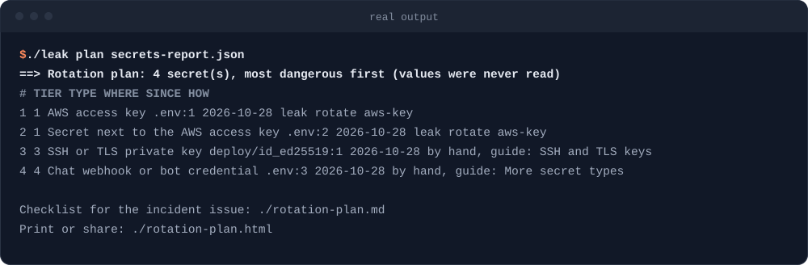
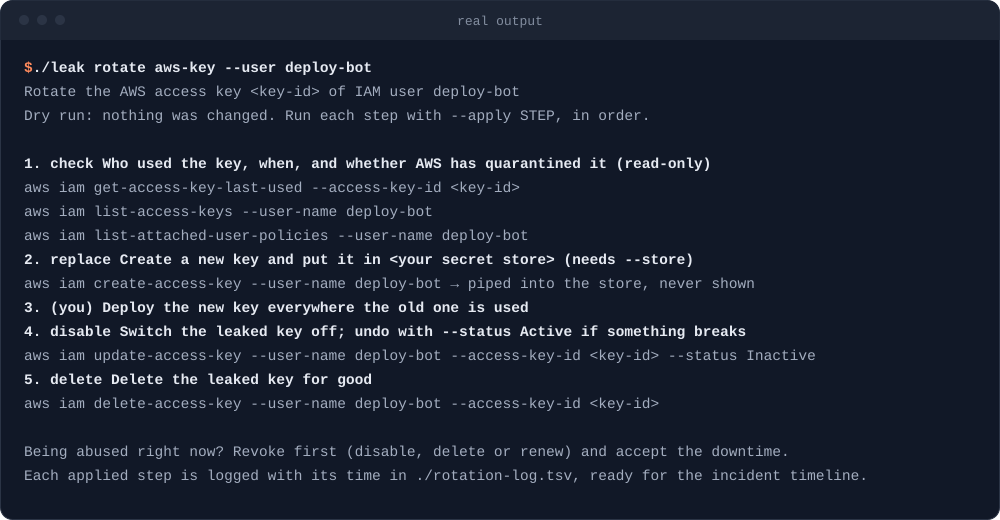
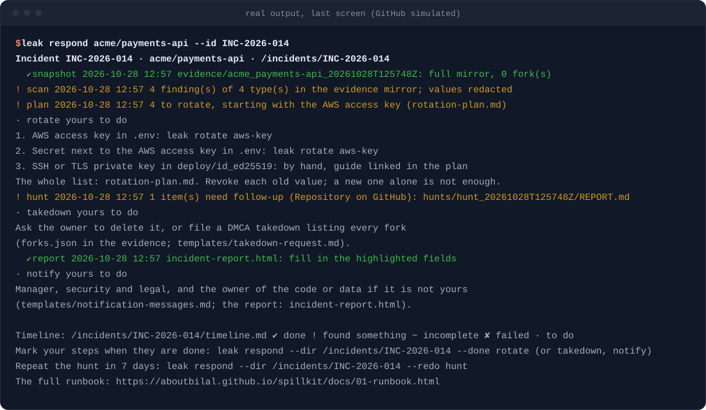
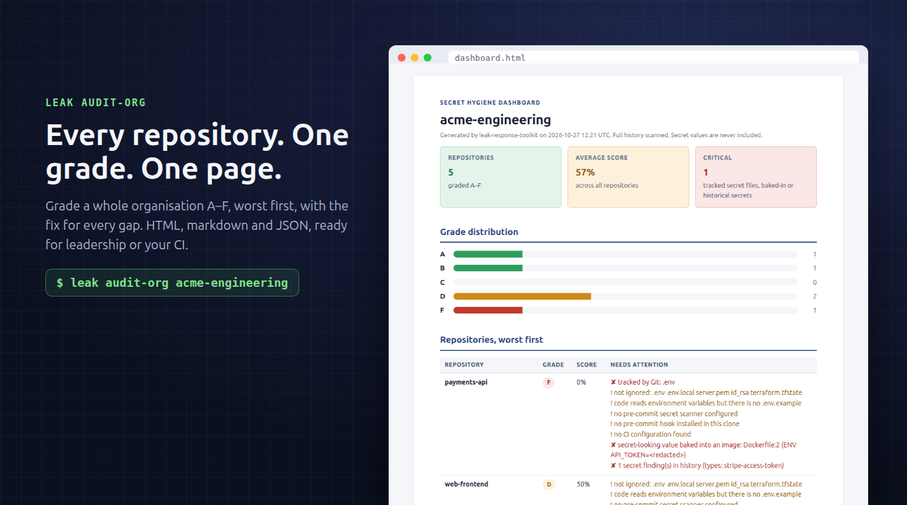
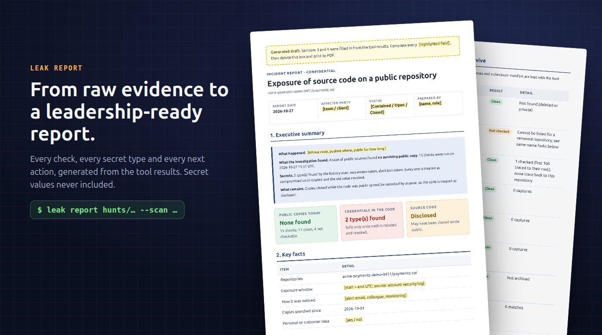

<p align="center">
  
</p>

<p align="center">
  <a href="https://github.com/aboutBilal/spillkit/actions/workflows/secret-scan.yml"></a>
  <a href="https://scorecard.dev/viewer/?uri=github.com/aboutBilal/spillkit"></a>
  <a href="https://github.com/aboutBilal/spillkit/releases/latest"></a>
  <a href="https://github.com/marketplace/actions/spillkit"></a>
  <a href="LICENSE"></a>
</p>

<p align="center"><b><a href="https://aboutbilal.github.io/spillkit/">Website</a></b> · <a href="#quick-start">Quick start</a> · <a href="docs/01-runbook.md">Incident runbook</a> · <a href="CHEATSHEET.md">15-minute cheat sheet</a></p>

> [!CAUTION]
> **Leaked a secret right now?** Rotate it first. Deleting the commit or the repository does not revoke it. Then follow the [15-minute cheat sheet](CHEATSHEET.md).

**Spillkit is the emergency kit for leaked secrets.** It blocks secrets before they are committed, finds every one already in your Git history, tells you which to rotate first and walks you through it, tracks down copies that survive deletion, and turns the evidence into an incident report your leadership can act on. It is free, open source and runs on your machine.

```bash
curl -fsSL https://github.com/aboutBilal/spillkit/releases/latest/download/install.sh | bash
leak demo     # a leak made for the purpose: audit, scan, rotation plan and a rotation dry run, in about a minute
```

## Why minutes matter

A `.env` file reaches a public repository at 14:02. Attackers watch public pushes continuously and have used exposed AWS keys [within five minutes](https://unit42.paloaltonetworks.com/malicious-operations-of-exposed-iam-keys-cryptojacking/). Deleting the repository at 14:30 changes little: forks, web archives and private clones keep the code, and the key keeps working until someone revokes it.

Spillkit covers both sides of that timeline: the controls that stop the file at 14:01, and the runbook, commands and report you need from 14:03.

- 28.6 million new hard-coded secrets reached public GitHub in 2025, 34% more than the year before, and 64% of the secrets leaked in 2022 were still exploitable four years later ([GitGuardian, 2026](https://www.gitguardian.com/state-of-secrets-sprawl-report-2026)).
- In our [measured test](docs/04-prevention.md#what-each-layer-catches-a-measured-test), GitHub push protection blocked 5 of 9 secret types. A pre-commit scan blocked all 9.

## What's in the kit

<p align="center">
  
</p>

| Stage | What you get | Start with |
|---|---|---|
| **Prevent** | Hooks that block `.env` files, keys and secrets at commit; CI templates for GitHub Actions, GitLab, Azure Pipelines and Bitbucket; keyless (OIDC) deployments | [Prevention kit](prevention/README.md) |
| **Grade** | An A to F hygiene score for one repository or a whole organisation, with the exact fix for each gap | `leak audit`, `leak audit-org` |
| **Detect** | Every commit on every branch scanned for secrets, including ones deleted later, or just a pull request's commits in seconds; values always redacted; SARIF for code scanning | `leak scan` |
| **Rotate** | A rotation plan from the scan, most dangerous first, with where to revoke each secret; guided rotation of AWS, Azure and Google Cloud keys and GitLab tokens, the new secret piped straight into your secret store | `leak plan`, `leak rotate` |
| **Respond** | One command that runs the first hour in order and keeps a UTC timeline; a runbook for each kind of leak, rotation steps for more than 25 secret types, and evidence preserved before it disappears | `leak respond`, [Runbook](docs/01-runbook.md) |
| **Hunt** | Eleven checks for surviving copies: forks, re-uploads on GitHub and GitLab, the Wayback Machine, Software Heritage and code search | `leak hunt` |
| **Report** | An incident report built from the evidence, structured like NIST SP 800-61r3, with FIRST TLP 2.0 handling labels | `leak report` |

Detection uses [gitleaks](https://github.com/gitleaks/gitleaks). Spillkit adds everything that has to happen before and after a scan.

## Install

**One line** (Linux and macOS, no root): downloads the latest release, checks its SHA-256 and, when [cosign](https://docs.sigstore.dev/cosign/system_config/installation/) is installed, its Sigstore signature, then puts `leak` in `~/.local/bin`.

```bash
curl -fsSL https://github.com/aboutBilal/spillkit/releases/latest/download/install.sh | bash
leak doctor        # confirms the machine is ready
```

Prefer to read it first: download [install.sh](install.sh), read it, then run `bash install.sh --require-signature`, which refuses to install anything whose signature it cannot verify.

**Homebrew** (macOS and Linux): brings gitleaks, jq and, on macOS, a current bash with it. The formula moves to each new release only after checking its checksum and Sigstore signature.

```bash
brew install aboutbilal/tap/spillkit
```

**Docker** (no local dependencies; signed image for amd64 and arm64):

```bash
docker run --rm -v "$PWD:/repo" ghcr.io/aboutbilal/spillkit audit /repo
```

**From source** (bash 4.4+, git, curl, jq, and gitleaks or Docker):

```bash
git clone https://github.com/aboutBilal/spillkit.git
cd spillkit && make install      # puts `leak` in ~/.local/bin
leak doctor                                   # confirms the machine is ready
```

**GitHub Actions**: see [CI integration](#ci-integration).

## Quick start

```bash
leak demo                        # see it work in about a minute, on a leak made for the purpose
leak audit .                     # grade this repository's secret hygiene, A to F, with a fix for each gap
leak scan .                      # find secrets in every commit and branch; values are always redacted
leak plan secrets-report.json    # what to rotate first, and where each one is revoked
```

<p align="center"></p>

<details>
<summary>Output of <code>leak scan</code></summary>
<br>
<p align="center"></p>
</details>

<details>
<summary>Output of <code>leak plan</code> and <code>leak rotate</code></summary>
<br>
<p align="center"></p>
<p align="center"></p>
</details>

<sub>Images show real output on demo repositories, rendered with <a href="tools/render-terminal-svg.py">tools/render-terminal-svg.py</a>. The test secrets were random and never stored.</sub>

## Responding to a leak

Pick the situation that matches, then follow the steps.

| Situation | Guide |
|---|---|
| A secret was committed to one of our public repositories | [Scenario A](docs/06-scenarios.md#a--a-secret-committed-to-your-own-public-repository) |
| A private repository was made public by mistake | [Scenario B](docs/06-scenarios.md#b--a-private-repository-was-made-public-by-mistake) |
| Our code was pushed to someone else's public account | [Runbook](docs/01-runbook.md) |
| A provider emailed us that a key was exposed | [Scenario D](docs/06-scenarios.md#d--a-provider-alert-your-key-was-exposed) |
| The secret leaked outside Git (gist, paste, CI log, image, package, chat) | [Scenario E](docs/06-scenarios.md#e--leaks-outside-git) |
| Someone outside the company reported it | [Scenario F](docs/06-scenarios.md#f--someone-reported-it-to-you) |

In a live incident, one command runs the first hour in order and keeps the record:

```bash
leak respond owner/repo           # snapshot, scan, plan, hunt and report, in an incident folder with a UTC timeline
leak respond --dir INC-... --status       # where it stands; run it again to continue where it stopped
```

<p align="center"></p>

It does every step that only reads, and tells you what is yours to do (rotating, the takedown, telling people), recording the time when you mark each one done. The steps, if you would rather run them one by one:

1. **Preserve evidence** before anything is deleted: `leak snapshot owner/repo`.
2. **Find every secret** in the full history: `leak scan <path>`.
3. **Rotate and revoke**, most powerful credential first: `leak plan secrets-report.json` puts them in order and says where each is revoked, and `leak rotate` takes AWS, Azure and Google Cloud keys and GitLab tokens through it step by step. The [rotation guide](docs/02-rotate-secrets.md) covers more than 25 secret types.
4. **Remove copies and look for others**: `leak forks`, `leak hunt`, `leak commits`, and the [takedown checklist](templates/takedown-request.md).
5. **Check for misuse** from the first push to the moment each secret was revoked: [investigation guide](docs/03-investigate.md).
6. **Communicate**: [message templates](templates/notification-messages.md), `leak report`, and a [team checklist](templates/incident-issue.md) for your tracker.

The full procedure is in the [runbook](docs/01-runbook.md); the [cheat sheet](CHEATSHEET.md) fits on one page. Teams that rehearse respond faster: the [45-minute drill](docs/07-practice-drill.md) needs no real secrets.

## Preventing leaks

Effective prevention is layered, and every layer assumes the one before it failed: pre-commit hooks on developer machines, push protection on the server, full-history scans in CI, no secrets in container images, keyless (OIDC) deployments, and a secret manager at runtime.

```bash
cp prevention/pre-commit-config.yaml ~/code/my-service/.pre-commit-config.yaml
cd ~/code/my-service && pre-commit install    # .env files, keys and secrets are now blocked at commit
```

Or use the hooks directly from this repository:

```yaml
# .pre-commit-config.yaml
repos:
  - repo: https://github.com/aboutBilal/spillkit
    rev: v3.7.1
    hooks:
      - id: forbid-secret-files    # no dependencies
      - id: leak-guard             # also scans staged changes with gitleaks
```

- [Secrets by design](docs/08-secrets-by-design.md) is written for architects and platform leads: principles, a reference architecture, an eight-layer control matrix, a maturity model, a 90-day rollout plan and metrics.
- The [prevention kit](prevention/README.md) is for engineers: hooks, CI templates for GitHub Actions, GitLab, Azure Pipelines and Bitbucket, OIDC login to AWS, Azure and Google Cloud, and Docker and `.env` patterns. Every file was tested before it was added.

This repository uses the kit on itself, and `leak audit .` grades it A.

## Organisation dashboard

`leak audit-org` grades every repository in a GitHub organisation, a GitLab group, a Bitbucket Cloud workspace, an Azure DevOps organisation or project, or a local folder of repositories, and writes an HTML report, a Markdown summary and JSON for automation. Repositories are listed worst first; every finding is labelled Critical or Fix and comes with its remedy, and the method section states exactly how grades are given.

```bash
leak audit-org my-org                         # GitHub; GITHUB_TOKEN adds private repositories
leak audit-org --gitlab my-group              # GitLab, with subgroups; GITLAB_TOKEN (read_api), GITLAB_URL if self-managed
leak audit-org --bitbucket my-workspace       # Bitbucket Cloud; BITBUCKET_TOKEN (an access token)
leak audit-org --azure-devops my-org/Project  # Azure DevOps; AZURE_DEVOPS_PAT (Code: Read)
leak audit-org --no-scan my-org               # faster: skips full-history scans
```

<p align="center"></p>

## Reports for leadership

`leak report` turns the results of `leak hunt` and `leak scan` into an incident report that reads like one a security team would write by hand:

- **Structure from NIST SP 800-61r3:** document control, a bottom-line summary with the decisions needed, a UTC timeline filled in from the tool runs, the investigation, the secrets to rotate, impact, a notification assessment, actions with owners and due dates, and root cause.
- **Evidence you can defend:** an appendix ties the report to the saved results with SHA-256 checksums.
- **Ready to circulate:** a [FIRST TLP 2.0](https://www.first.org/tlp/) handling label, the incident ID and "Page X of Y" on every printed page.
- **No secrets, ever:** secret types and counts only.

Facts only people know, such as the exposure window and severity, stay highlighted for you to complete. Use `leak report --blank` for a report to fill in by hand.

```bash
leak report hunts/hunt_20261027T142000Z --scan secrets-report.json --id INC-2026-014 --tlp amber+strict
```

<p align="center"></p>

## CI integration

```yaml
# .github/workflows/secrets.yml
on: [push, pull_request]
permissions:
  contents: read
  security-events: write          # only needed to upload SARIF
jobs:
  secrets:
    runs-on: ubuntu-latest
    steps:
      - uses: actions/checkout@3d3c42e5aac5ba805825da76410c181273ba90b1 # v7.0.1
        with: { fetch-depth: 0, persist-credentials: false }
      - uses: aboutBilal/spillkit@v3   # pin to a commit SHA in production
        with:
          mode: scan                                # scan, audit, audit-org or hunt
          scope: history                            # or changes: only what a pull request or push adds
          sarif-file: leak.sarif                    # scan and audit modes
          webhook-url: ${{ secrets.SECURITY_WEBHOOK }} # optional: Slack, Teams or Discord
      - uses: github/codeql-action/upload-sarif@9b3254085494b55a0f7c4c2b3d2d52cc712ce370 # v4.39.1
        if: always()
        with: { sarif_file: leak.sarif }
```

The Action is listed on the [GitHub Marketplace](https://github.com/marketplace/actions/spillkit). Findings appear in the job summary and, with SARIF, in the repository's Security tab. When a scan finds secrets, the summary also lists what to rotate first, where each is revoked and the `leak rotate` recipe for it; the full plan, with files and commits, is at the `plan` output (upload it as an artifact from private repositories only). Alerts are sent only when something is found and never contain secret values. A scheduled `mode: hunt` job on your most sensitive repositories works as low-cost public-leak monitoring.

On a large repository, scan pull requests with `scope: changes`: only the commits the pull request adds are scanned, in seconds, so the check stays on every PR. Keep a `scope: history` scan on `main` or on a schedule, which also catches anything pushed around the pull requests. If the range cannot be found (a branch's first push, or a shallow checkout), the Action scans the full history and says so.

## Command reference

| Command | Purpose |
|---|---|
| `leak audit [--json] [--sarif file] [path]` | Grade a repository's secret hygiene from A to F, with a fix for each gap; SARIF for code scanning |
| `leak audit-org [--no-scan] <org>` | Grade every repository in a GitHub organisation (or `--gitlab`, `--bitbucket`, `--azure-devops`, `--dir`); HTML report, Markdown and JSON |
| `leak respond owner/repo [--dir d]` | Run the first hour of an incident in order (snapshot, scan, plan, hunt, report) in one folder with a UTC timeline; run it again to continue, `--done` to record your steps, `--redo hunt` a week later |
| `leak scan <path> [--sarif file] [--commits A..B]` | Scan every commit for secrets, or only a range such as a pull request's; values are always redacted |
| `leak plan <secrets-report.json>` | Turn a scan into a rotation checklist, most dangerous first: Markdown for the incident issue, HTML to print |
| `leak rotate <recipe> [--apply step]` | Rotate an AWS access key, Azure app secret, Google Cloud service account key, Azure storage key or GitLab access token, one step at a time; a dry run unless you name a step |
| `leak snapshot owner/repo` | Preserve a leaked repository: mirror, metadata, forks, traffic and a checksum manifest |
| `leak forks owner/repo` | List every fork, including forks of forks, for a takedown request |
| `leak hunt [--since date] owner/repo` | Check GitHub, GitLab, web archives and code search for surviving copies |
| `leak commits <sha>…` | Find public repositories that contain the original commits |
| `leak report <hunt-dir> [--scan file] [--id ID] [--tlp label]` | Build the incident report from the results (`--blank` for an empty one) |
| `leak notify "message"` | Send an alert to Slack, Teams or Discord (URL from `LEAK_WEBHOOK_URL`) |
| `leak doctor` | Check that a machine has everything it needs, before an incident |
| `leak demo` | Build a leak made for the purpose and run audit, scan, plan and a rotation dry run on it |

Every command has `--help`. Exit codes are the same everywhere: `0` clean, `1` findings, `2` usage error, `4` incomplete (a scanner or remote service failed, so the result must not be read as clean).

## Security of the toolkit

A tool that handles leak investigations has to be trustworthy itself. Each of these can be checked independently:

- Release archives, the install script and container images are signed with [Sigstore](https://www.sigstore.dev/). [How to verify](SECURITY.md#verifying-a-release).
- Release archives and the install script carry SLSA build provenance; container images ship with an SBOM and SLSA build provenance.
- [OpenSSF Scorecard](https://scorecard.dev/viewer/?uri=github.com/aboutBilal/spillkit) runs on every push to `main`.
- GitHub Actions are pinned to commit SHAs and container images to digests; Dependabot keeps them current.
- Every push runs shellcheck, actionlint, 58 offline tests on Linux and macOS, and a full-history secret scan; CodeQL analyses every change to `main` and every pull request.
- No command prints or tests a secret value, and tests enforce this. `leak snapshot` keeps a copy of a leaked repository as evidence, so evidence folders are git-ignored and must be handled as sensitive. The repository itself contains no secrets, not even fake ones.
- Tokens and webhook URLs are passed to `curl` on standard input, never as command-line arguments, so they do not appear in process lists.
- `leak rotate` is the only command that changes anything. It is a dry run unless you name a step with `--apply`, asks before it disables or deletes, and pipes a new secret from the provider straight into your secret store: never shown, never written to disk, never in a command line.
- A source that fails or is rate-limited is reported as "not checked", never as clean.

Report vulnerabilities privately; see [SECURITY.md](SECURITY.md).

## Comparison

This is not another secret scanner. It uses gitleaks and adds prevention, response and reporting around it, so it works alongside the tools you may already use.

| Capability | gitleaks | TruffleHog | GitGuardian | Spillkit |
|---|---|---|---|---|
| Scan full Git history | Yes | Yes | Yes | Yes (gitleaks) |
| Check whether a found secret is still live | No | Yes | Yes | No, by design |
| Block secrets at commit | Yes | Yes | Yes | Yes, plus blocked file types |
| Grade repositories and organisations | No | No | No | Yes |
| Incident runbooks per leak scenario | No | No | Partial | Yes |
| Rotation plan and guided rotation | No | No | Remediation guides | Yes |
| Search public sources for surviving copies | No | No | Continuous (commercial) | On demand |
| Leadership report from the evidence | No | No | Dashboards | Yes |
| Licence | MIT | AGPL-3.0 | Commercial | MIT |

## FAQ

<details>
<summary>Does it send code or secrets anywhere?</summary>

No. `scan`, `audit` and `plan` run locally, and `rotate` calls your cloud provider's own CLI, or the GitLab API, only for the steps you apply. `hunt`, `forks`, `commits` and `audit-org` send only repository names, account names and commit IDs to public services: GitHub, GitLab, the Internet Archive, Software Heritage, Sourcegraph, Codeberg and the public GitHub event dataset at play.clickhouse.com. Alerts contain counts and secret types, never values.
</details>

<details>
<summary>Why doesn't it check whether a leaked key still works?</summary>

Using a leaked credential is what an attacker does, and it can trigger alarms or breach a provider's terms. The response is the same either way: rotate it.
</details>

<details>
<summary>Does it work outside GitHub?</summary>

`scan`, `audit`, the hooks and the CI templates work with any Git repository on GitHub, GitLab, Azure DevOps or Bitbucket, and `audit-org` lists repositories from all four. `hunt` searches public GitHub, public GitLab and web and code archives.
</details>

<details>
<summary>Can my company use and modify it?</summary>

Yes. It is MIT-licensed. Adapt the runbooks to your organisation and ship the prevention kit in your templates.
</details>

<details>
<summary>What is in the repository?</summary>

| Path | Contents |
|---|---|
| `docs/` | Runbook, scenarios, rotation, investigation, where copies survive, prevention, secrets by design, practice drill |
| `prevention/` | Tested hooks, gitleaks configuration, CI templates, OIDC examples, Docker and `.env` patterns |
| `scripts/` | The commands behind `leak`, and the catalog of secret types that orders a rotation plan |
| `templates/` | Incident checklist, timeline, messages, takedown request, post-incident review, incident report |
| `action.yml`, `Dockerfile`, `.pre-commit-hooks.yaml` | GitHub Action, container image, pre-commit hooks |
| `tests/` | Offline test suite (bats) |
</details>

## Contributing

Contributions based on real incidents are especially welcome: a missing step, another platform, a better command. Please read [CONTRIBUTING.md](CONTRIBUTING.md) first. Two rules are firm: no secrets in the repository, not even fake ones, and no details of real incidents or people. Planned work is in the [roadmap](ROADMAP.md).

```bash
make check    # shellcheck, tests and a secret scan: the same checks CI runs
```

## License

[MIT](LICENSE). See also the [changelog](CHANGELOG.md), [code of conduct](CODE_OF_CONDUCT.md) and [citation file](CITATION.cff).

<sub>The scripts read only public data and the repositories you point them at. This project is engineering guidance, not legal advice; breach-notification duties depend on what leaked and where you operate.</sub>
