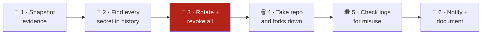
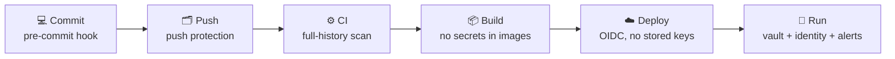

<p align="center">
  
</p>

<p align="center">
  <a href="https://github.com/aboutBilal/leak-response-toolkit/actions/workflows/secret-scan.yml"></a>
  <a href="CHANGELOG.md"></a>
  <a href="LICENSE"></a>
  <a href="CONTRIBUTING.md"></a>
</p>

<h3 align="center">Stop secrets from leaking, and when they do, respond in minutes.<br>Architecture, tested prevention configs, incident runbooks and tools in one kit.</h3>

<p align="center">
  <a href="#-start-here-what-happened"><b>🚨 In an incident? Start here</b></a> ·
  <a href="#-prevent-it-secrets-by-design"><b>🛡️ Prevent it</b></a> ·
  <a href="CHEATSHEET.md">📄 Cheat sheet</a> ·
  <a href="docs/01-runbook.md">📘 Runbook</a> ·
  <a href="docs/07-practice-drill.md">🎯 Drill</a>
</p>

---

## ⚡ Why minutes matter

| ⏱️ **5 minutes** | 📈 **28.6 million** | 🧟 **64%** | 🛡️ **5 of 9** |
|:-:|:-:|:-:|:-:|
| Time attackers needed to find and use AWS keys exposed on public GitHub ([Unit 42, 2023](https://unit42.paloaltonetworks.com/malicious-operations-of-exposed-iam-keys-cryptojacking/)) | New hard-coded secrets pushed to public GitHub in 2025, up 34% ([GitGuardian, 2026](https://www.gitguardian.com/state-of-secrets-sprawl-report-2026)) | Secrets leaked in 2022 that were still exploitable four years later ([GitGuardian, 2026](https://www.gitguardian.com/state-of-secrets-sprawl-report-2026)) | Secret types GitHub push protection blocked in our test, while gitleaks caught 9 of 9 ([measured](docs/04-prevention.md#-what-each-layer-catches-a-measured-test)) |

> [!IMPORTANT]
> **Rotate first, delete second.** Deleting a repository does not un-leak anything; a revoked key does. Everything else in this kit limits the spread and tells you what happened.

---

## 🧩 Two halves, one kit

| 🛡️ **Prevent** (before) | 🚑 **Respond** (during and after) |
|---|---|
| [Secrets by design](docs/08-secrets-by-design.md): principles, reference architecture, control matrix, maturity model, 90-day rollout, metrics | [Runbook](docs/01-runbook.md) and [scenarios](docs/06-scenarios.md) for every kind of leak |
| [Prevention kit](prevention/README.md): tested hooks, CI templates for 4 platforms, keyless cloud login, Docker and `.env` patterns | [Rotate](docs/02-rotate-secrets.md) 25+ secret types, [investigate](docs/03-investigate.md) misuse, [hunt copies](docs/05-where-copies-survive.md) |
| `./leak audit`: grade any repository A–F, with a fix for each gap | `./leak scan · hunt · report`: from evidence to a leadership report |

---

## 🧭 Start here: what happened?

| Situation | Go to |
|---|---|
| 🔑 I committed a secret to a public repo | [Scenario A](docs/06-scenarios.md#a--a-secret-committed-to-your-own-public-repository) |
| 🔓 A private repo was made public by mistake | [Scenario B](docs/06-scenarios.md#b--a-private-repository-was-made-public-by-mistake) |
| 📤 Our code was pushed to someone else's public account | [Full runbook](docs/01-runbook.md) |
| 📧 A provider emailed: "your key was exposed" | [Scenario D](docs/06-scenarios.md#d--a-provider-alert-your-key-was-exposed) |
| 📦 It leaked outside Git: gist, paste, CI logs, image, package, chat | [Scenario E](docs/06-scenarios.md#e--leaks-outside-git) |
| 🙋 Someone reported it to us | [Scenario F](docs/06-scenarios.md#f--someone-reported-it-to-you) |

Whatever the case, the first move is the same: **rotate the exposed secrets** ([how, per secret type](docs/02-rotate-secrets.md)).

---

## ⏱️ The first hour on one page



| Step | Do | Tool here |
|:-:|---|---|
| 1 | Save a copy of the leaked repo, its metadata and forks **before** anything is deleted | `./leak snapshot` |
| 2 | Scan the **full history**, not only the latest commit | `./leak scan` |
| 3 | Rotate and **revoke** every secret found, most powerful first | [`docs/02-rotate-secrets.md`](docs/02-rotate-secrets.md) |
| 4 | Delete the repo or file a takedown (every fork too), then **hunt for other copies** | `./leak forks`, `./leak hunt`, `./leak commits`, [takedown request](templates/takedown-request.md) |
| 5 | Search logs from the **first push** to the **moment each key was rotated** | [`docs/03-investigate.md`](docs/03-investigate.md) |
| 6 | Tell the right people, keep a timeline, report to leadership | [messages](templates/notification-messages.md), [timeline](templates/incident-timeline.md), [executive report](templates/executive-report.html) |

The full walkthrough is in **[`docs/01-runbook.md`](docs/01-runbook.md)**. To track the response as a team, paste [`templates/incident-issue.md`](templates/incident-issue.md) into a private issue.

---

## 🚀 Quick start

```bash
git clone https://github.com/aboutBilal/leak-response-toolkit.git
cd leak-response-toolkit
./leak help
```

| Command | What it does |
|---|---|
| `./leak snapshot someuser/leaked-repo` | Saves a full mirror, metadata, forks and (with the owner's token) traffic, plus a checksum manifest |
| `./leak scan <path>` | Scans **every commit** for secrets; values are always redacted |
| `./leak forks someuser/leaked-repo` | Lists every fork, including forks of forks, for the takedown |
| `./leak hunt --since 2026-01-31 someuser/leaked-repo` | Checks 15+ public sources for surviving copies and writes a markdown report |
| `./leak commits --exclude someuser/leaked-repo <sha> <sha>` | Finds renamed re-uploads that carry the original commits |
| `./leak report hunts/hunt_<time> --scan report.json` | Builds the print-ready leadership report from the results (types only, never values) |
| `./leak audit [path]` | Grades a repository's secret hygiene A–F, with a fix for every gap |
| `./leak doctor` | Checks a machine is ready **before** an incident: tools, scanner, token, API budget |

<p align="center"></p>

**Needs:** `git`, `curl`, `jq`, and either [`gitleaks`](https://github.com/gitleaks/gitleaks) or Docker (the scan script falls back to the official gitleaks image).
Optional: set `GITHUB_TOKEN` for higher API limits; if the token belongs to the repo owner, the snapshot also saves **clone and visitor traffic** for the last 14 days.

---

## 🗂️ What is in here

```
leak-response-toolkit/
├── docs/
│   ├── 01-runbook.md                the full response, step by step
│   ├── 02-rotate-secrets.md         rotation per secret type (Azure, AWS, Google Cloud, GitHub, DBs, SSH, app secrets)
│   ├── 03-investigate.md            log queries: was the key used?
│   ├── 04-prevention.md             layers that stop leaks, with a measured test of what each catches
│   ├── 05-where-copies-survive.md   archives, forks, re-uploads, evidence that disappears, removal requests
│   ├── 06-scenarios.md              what changes per leak type: own repo, made public, copied, alerts, non-Git leaks
│   ├── 07-practice-drill.md         a 45-minute team exercise, no real secrets
│   └── 08-secrets-by-design.md      architecture: principles, control matrix, maturity model, rollout
├── prevention/                      tested, copy-ready: hooks, CI for 4 platforms, OIDC, Docker, .env
├── scripts/                         every script has --help
│   ├── snapshot-evidence.sh         mirror + metadata + forks + traffic, with a checksum manifest
│   ├── scan-secrets.sh              full-history scan, redacted summary
│   ├── list-forks.sh                every fork, for the takedown request
│   ├── hunt-copies.sh               15+ public sources checked, dated markdown report
│   ├── find-commit-copies.sh        public repos containing the original commit IDs
│   ├── make-report.sh               leadership report from hunt + scan results
│   ├── audit.sh                     secret hygiene grade A–F
│   └── doctor.sh                    readiness check before an incident
├── templates/
│   ├── incident-issue.md            team checklist to paste into a private issue
│   ├── incident-timeline.md         fill-in timeline and decision log
│   ├── notification-messages.md     leadership, affected customers, the person involved, reporters
│   ├── takedown-request.md          the facts a GitHub DMCA notice needs
│   ├── post-incident-review.md      blameless review with actions and owners
│   └── executive-report.html        leadership report, print-ready A4
├── leak                             one command for every script: ./leak help
├── action.yml                       GitHub Action: scan, audit or hunt in any CI
├── CHEATSHEET.md                    the first 15 minutes on one page
├── tests/scripts.bats               16 offline tests; test secrets generated at runtime
├── Makefile                         make check = shellcheck + tests + secret scan
└── .github/                         CI (secrets, shellcheck, tests, links, action self-test), Dependabot, templates
```

---

## 🔒 Prevent it: secrets by design

Most leaks are preventable with layers that each assume the previous one failed:



```bash
# Grade your repository and get a fix for each gap
./leak audit ~/code/my-service

# Block .env files, keys and secrets at commit time (tested)
cp prevention/pre-commit-config.yaml ~/code/my-service/.pre-commit-config.yaml
cd ~/code/my-service && pre-commit install
```

| Read | For |
|---|---|
| [**08 · Secrets by design**](docs/08-secrets-by-design.md) | Architects and platform leads: principles, control matrix, maturity levels 0–4, 90-day rollout, metrics, design-review checklist |
| [**Prevention kit**](prevention/README.md) | Engineers: copy-ready files for Git, CI (GitHub, GitLab, Azure Pipelines, Bitbucket), OIDC to AWS/Azure/Google Cloud, Docker, `.env` |
| [04 · Prevention](docs/04-prevention.md) | The short version, with a measured test of what push protection and gitleaks catch |

> [!TIP]
> **This repository follows its own advice:** it uses the kit's hooks and ignore rules, scans its full history in CI, and `./leak audit .` gives it **Grade A**.

---

## 🤖 Use it in your CI (GitHub Action)

```yaml
# .github/workflows/secrets.yml
on: [push, pull_request]
permissions:
  contents: read
jobs:
  secrets:
    runs-on: ubuntu-latest
    steps:
      - uses: actions/checkout@3d3c42e5aac5ba805825da76410c181273ba90b1 # v7.0.1
        with: { fetch-depth: 0, persist-credentials: false }
      - uses: aboutBilal/leak-response-toolkit@v2   # pin to a commit SHA in production
        with:
          mode: scan        # or: audit (grade A-F), hunt (public copies of `repos`)
```

Results appear in the job summary; secret values are always redacted. A weekly `mode: hunt` job on your critical repositories doubles as cheap public-leak monitoring.

---

## ⚖️ Scope

- These scripts **only read** public data and the repository you point them at. They never use, test or print a discovered secret.
- Commands in the docs use placeholders like `<app-id>`; nothing here is a real credential.
- This is an engineering checklist, not legal advice. Breach-notification duties (for example GDPR's 72 hours) depend on what data leaked and where you operate.

## 🤝 Contributing

Improvements from real experience are welcome: a missing step, another platform, a better command. Read [CONTRIBUTING.md](CONTRIBUTING.md) first; the two hard rules are **no secrets, not even fake ones**, and **no real incidents or names**. Security problems: [SECURITY.md](SECURITY.md).

```bash
make check   # shellcheck + offline tests + secret scan: the same as CI
```

## 📄 License

[MIT](LICENSE) · [Changelog](CHANGELOG.md) · [Code of conduct](CODE_OF_CONDUCT.md)
