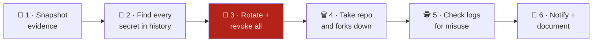

# 🔐 Leak Response Toolkit

**A free, step-by-step kit for anyone whose code or secrets ended up somewhere public: what to do in the first hours, how to check where copies survive, and how to stop it happening again.**

It covers the common cases: a key committed to a public repo, a private repo made public by mistake, code copied to someone else's account, a "your key was exposed" email from a provider, and secrets leaked through gists, logs, images or packages. Even a few minutes of exposure means the secrets must be treated as stolen.

> [!IMPORTANT]
> **Rotate first, delete second.** Bots watch every public push to GitHub and harvest keys within minutes. Deleting the repo does not un-leak anything; a revoked key does.

---

## 🧭 Start here: what happened?

| Situation | Go to |
|---|---|
| 🔑 I committed a secret to a public repo | [Scenario A](docs/06-scenarios.md#a--a-secret-committed-to-your-own-public-repository) |
| 🔓 A private repo was made public by mistake | [Scenario B](docs/06-scenarios.md#b--a-private-repository-was-made-public-by-mistake) |
| 📤 Our code was pushed to someone else's public account | [Full runbook](docs/01-runbook.md) |
| 📧 A provider emailed: "your key was exposed" | [Scenario D](docs/06-scenarios.md#d--a-provider-alert-your-key-was-exposed) |
| 📦 It leaked outside Git: gist, paste, CI logs, image, package, chat | [Scenario E](docs/06-scenarios.md#e--leaks-outside-git) |
| 🙋 Someone reported it to us | [Scenario F](docs/06-scenarios.md#f--someone-reported-it-to-you) |

Whatever the case, the first move is the same: **rotate the exposed secrets** ([how, per secret type](docs/02-rotate-secrets.md)).

---

## ⏱️ The first hour on one page



| Step | Do | Tool here |
|:-:|---|---|
| 1 | Save a copy of the leaked repo, its metadata and forks **before** anything is deleted | [`scripts/snapshot-evidence.sh`](scripts/snapshot-evidence.sh) |
| 2 | Scan the **full history**, not only the latest commit | [`scripts/scan-secrets.sh`](scripts/scan-secrets.sh) |
| 3 | Rotate and **revoke** every secret found, most powerful first | [`docs/02-rotate-secrets.md`](docs/02-rotate-secrets.md) |
| 4 | Delete the repo or file a takedown (every fork too), then **hunt for other copies** | [`scripts/hunt-copies.sh`](scripts/hunt-copies.sh), [`scripts/find-commit-copies.sh`](scripts/find-commit-copies.sh), [`templates/takedown-request.md`](templates/takedown-request.md) |
| 5 | Search logs from the **first push** to the **moment each key was rotated** | [`docs/03-investigate.md`](docs/03-investigate.md) |
| 6 | Tell the right people, keep a timeline, report to leadership | [`templates/incident-timeline.md`](templates/incident-timeline.md), [`templates/executive-report.html`](templates/executive-report.html) |

The full walkthrough is in **[`docs/01-runbook.md`](docs/01-runbook.md)**.

---

## 🚀 Quick start

```bash
git clone https://github.com/aboutBilal/leak-response-toolkit.git
cd leak-response-toolkit

# 1. Snapshot the leaked repo (metadata, forks, full mirror)
./scripts/snapshot-evidence.sh someuser/leaked-repo

# 2. Scan its whole history for secrets (values are redacted in the output)
./scripts/scan-secrets.sh evidence/someuser_leaked-repo_*/repo.git

# 3. List forks that also need a takedown
./scripts/list-forks.sh someuser/leaked-repo

# 4. Hunt for surviving copies: archives, re-uploads, mirrors, code search (markdown report)
./scripts/hunt-copies.sh --since 2026-01-31 someuser/leaked-repo

# 5. Find renamed re-uploads by commit IDs from the ORIGINAL repository
./scripts/find-commit-copies.sh --exclude someuser/leaked-repo <first-commit-sha> <recent-commit-sha>
```

**Needs:** `git`, `curl`, `jq`, and either [`gitleaks`](https://github.com/gitleaks/gitleaks) or Docker (the scan script falls back to the official gitleaks image).
Optional: set `GITHUB_TOKEN` for higher API limits; if the token belongs to the repo owner, the snapshot also saves **clone and visitor traffic** for the last 14 days.

---

## 🗂️ What is in here

```
leak-response-toolkit/
├── docs/
│   ├── 01-runbook.md            the full response, step by step
│   ├── 02-rotate-secrets.md     rotation per secret type (Azure, AWS, Google Cloud, GitHub, DBs, SSH, app secrets)
│   ├── 03-investigate.md        log queries: was the key used?
│   ├── 04-prevention.md         layers that stop leaks, with a measured test of what each catches
│   ├── 05-where-copies-survive.md   archives, forks, re-uploads, evidence that disappears, removal requests
│   └── 06-scenarios.md          what changes per leak type: own repo, made public, copied, alerts, non-Git leaks
├── scripts/
│   ├── snapshot-evidence.sh     mirror + metadata + forks + traffic, with a checksum manifest
│   ├── scan-secrets.sh          full-history scan, redacted summary
│   ├── list-forks.sh            every fork, for the takedown request
│   ├── hunt-copies.sh           15+ public sources checked, dated markdown report
│   └── find-commit-copies.sh    public repos containing the original commit IDs
├── templates/
│   ├── incident-timeline.md     fill-in timeline and decision log
│   ├── takedown-request.md      the facts a GitHub DMCA notice needs
│   └── executive-report.html    leadership report, print-ready A4
├── .pre-commit-config.yaml      gitleaks before every commit
├── .github/workflows/secret-scan.yml   gitleaks + shellcheck on every push and PR
└── SECURITY.md                  how to report a problem privately
```

---

## 🛡️ Prevention in two commands

This repository protects itself the same way it recommends:

```bash
pipx install pre-commit     # or: uv tool install pre-commit
pre-commit install          # gitleaks now runs before every commit
```

And CI runs the same scan on every push ([`secret-scan.yml`](.github/workflows/secret-scan.yml)). The bigger wins, such as removing long-lived keys entirely, are in [`docs/04-prevention.md`](docs/04-prevention.md).

> [!TIP]
> **Measured, not assumed:** in a test with one fake credential of each of 9 types, GitHub push protection blocked 5 and gitleaks caught all 9. Details in [`docs/04-prevention.md`](docs/04-prevention.md#-what-each-layer-catches-a-measured-test).

---

## ⚖️ Scope

- These scripts **only read** public data and the repository you point them at. They never use, test or print a discovered secret.
- Commands in the docs use placeholders like `<app-id>`; nothing here is a real credential.
- This is an engineering checklist, not legal advice. Breach-notification duties (for example GDPR's 72 hours) depend on what data leaked and where you operate.

## 📄 License

[MIT](LICENSE)
