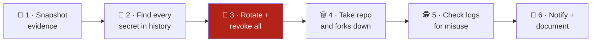

# 🔐 Leak Response Toolkit

**What to do in the first hours after company code or secrets end up in a public Git repository, and how to stop it happening again.**

A typical case: a developer clones a private company repository and pushes it to a personal GitHub account as a public repo. Even if it is public for only a few hours, any secrets inside it must be treated as stolen.

> [!IMPORTANT]
> **Rotate first, delete second.** Bots watch every public push to GitHub and harvest keys within minutes. Deleting the repo does not un-leak anything; a revoked key does.

---

## ⏱️ The first hour on one page



| Step | Do | Tool here |
|:-:|---|---|
| 1 | Save a copy of the leaked repo, its metadata and forks **before** anything is deleted | [`scripts/snapshot-evidence.sh`](scripts/snapshot-evidence.sh) |
| 2 | Scan the **full history**, not only the latest commit | [`scripts/scan-secrets.sh`](scripts/scan-secrets.sh) |
| 3 | Rotate and **revoke** every secret found, most powerful first | [`docs/02-rotate-secrets.md`](docs/02-rotate-secrets.md) |
| 4 | Delete the repo, or file a takedown, including every fork | [`scripts/list-forks.sh`](scripts/list-forks.sh), [`templates/takedown-request.md`](templates/takedown-request.md) |
| 5 | Search logs from the **first push** to the **moment each key was rotated** | [`docs/03-investigate.md`](docs/03-investigate.md) |
| 6 | Tell the right people and keep a timeline | [`templates/incident-timeline.md`](templates/incident-timeline.md) |

The full walkthrough is in **[`docs/01-runbook.md`](docs/01-runbook.md)**.

---

## 🚀 Quick start

```bash
git clone https://github.com/aboutBilal/leak-response-toolkit.git
cd leak-response-toolkit

# 1. Snapshot the leaked repo (metadata, forks, full mirror)
./scripts/snapshot-evidence.sh someuser/leaked-repo

# 2. Scan its whole history for secrets (values are redacted in the output)
./scripts/scan-secrets.sh evidence/someuser_leaked-repo_*/repo.git

# 3. List forks that also need a takedown
./scripts/list-forks.sh someuser/leaked-repo
```

**Needs:** `git`, `curl`, `jq`, and either [`gitleaks`](https://github.com/gitleaks/gitleaks) or Docker (the scan script falls back to the official gitleaks image).
Optional: set `GITHUB_TOKEN` for higher API limits; if the token belongs to the repo owner, the snapshot also saves **clone and visitor traffic** for the last 14 days.

---

## 🗂️ What is in here

```
leak-response-toolkit/
├── docs/
│   ├── 01-runbook.md            the incident, step by step
│   ├── 02-rotate-secrets.md     rotation commands per secret type (Azure, AWS, GitHub, DBs, SSH, JWT)
│   ├── 03-investigate.md        log queries: was the key used?
│   └── 04-prevention.md         push protection, pre-commit, short-lived credentials, policy
├── scripts/
│   ├── snapshot-evidence.sh     mirror + metadata + forks + traffic, with a checksum manifest
│   ├── scan-secrets.sh          full-history scan, redacted summary
│   └── list-forks.sh            every fork, for the takedown request
├── templates/
│   ├── incident-timeline.md     fill-in timeline and decision log
│   └── takedown-request.md      the facts a GitHub DMCA notice needs
├── .pre-commit-config.yaml      gitleaks before every commit
└── .github/workflows/secret-scan.yml   gitleaks on every push and PR
```

---

## 🛡️ Prevention in two commands

This repository protects itself the same way it recommends:

```bash
pipx install pre-commit     # or: uv tool install pre-commit
pre-commit install          # gitleaks now runs before every commit
```

And CI runs the same scan on every push ([`secret-scan.yml`](.github/workflows/secret-scan.yml)). The bigger wins, such as removing long-lived keys entirely, are in [`docs/04-prevention.md`](docs/04-prevention.md).

---

## ⚖️ Scope

- These scripts **only read** public data and the repository you point them at. They never use, test or print a discovered secret.
- Commands in the docs use placeholders like `<app-id>`; nothing here is a real credential.
- This is an engineering checklist, not legal advice. Breach-notification duties (for example GDPR's 72 hours) depend on what data leaked and where you operate.

## 📄 License

[MIT](LICENSE)
