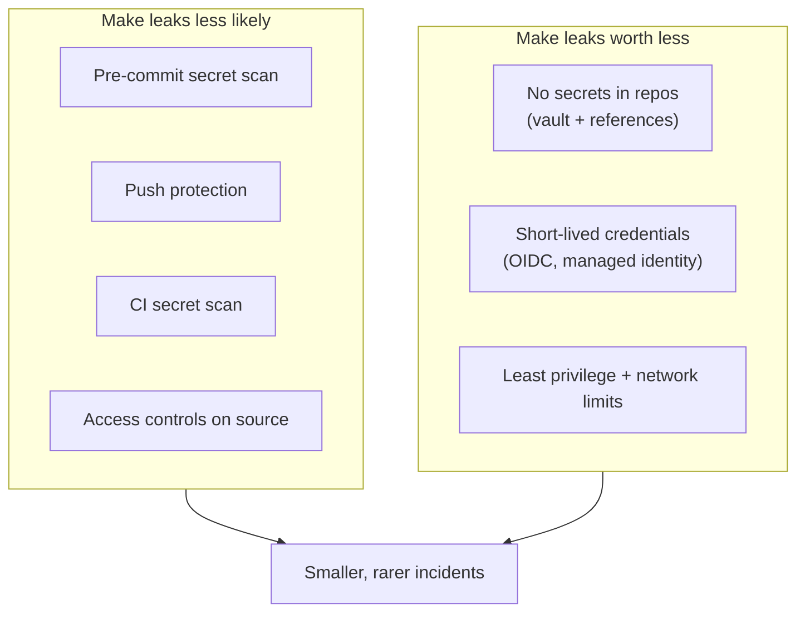

# 04 · Prevention

> [!TIP]
> This page is the short version. For the full architecture (principles, control matrix, maturity model, 90-day rollout, metrics), read [**08 · Secrets by design**](08-secrets-by-design.md). For tested, ready-to-copy files, use the [**prevention kit**](../prevention/README.md), and grade any repository with `./leak audit`.

Two layers: **make a leak less likely**, and **make a leak worth less**. The second matters more, because the first always fails eventually.



---

## Make a leak worth less (do these first)

| Change | Effect |
|---|---|
| **Secrets live in a vault** (Azure Key Vault, AWS Secrets Manager, HashiCorp Vault), and code holds only references | A leaked repo holds no keys at all |
| **Managed identities** for apps on Azure; **IAM roles** on AWS | No secret exists to leak |
| **Workload identity federation (OIDC)** for CI: GitHub Actions, Azure Pipelines | Pipelines get 1-hour tokens instead of stored keys |
| **Least privilege**: one identity per app, scoped to its resource group | A stolen key opens one room, not the building |
| **Network limits**: private endpoints, firewall allow-lists on databases and storage | A stolen password is useless from the internet |
| **Expiry on every secret** that must exist (e.g. app secrets ≤ 6 months) | Old leaks age out |

---

## Make a leak less likely

### Before the commit: pre-commit hook

This repo ships [`.pre-commit-config.yaml`](../.pre-commit-config.yaml):

```bash
pipx install pre-commit
pre-commit install
```

gitleaks then blocks any commit that contains a secret. It runs locally, so it is fast and nothing leaves the machine.

### At the push: GitHub push protection

*Settings → Code security → Secret scanning → Push protection*. GitHub rejects pushes containing recognised secrets. It is on by default for public repositories; organisations can enforce it for private ones.

### After the push: CI scan

[`.github/workflows/secret-scan.yml`](../.github/workflows/secret-scan.yml) runs gitleaks on every push and pull request, over the full history. A finding fails the check.

### What each layer catches: a measured test

A test branch with one **fake** credential of each type was pushed to a public repository on 26 October 2026 (the values were random and the branch was never accepted, so no secret exists in this repository):

| Secret type | GitHub push protection | gitleaks (pre-commit / CI) |
|---|:-:|:-:|
| AWS access key ID | blocked | |
| AWS secret access key | blocked | |
| Azure storage account key | blocked | |
| Slack bot token | blocked | |
| Stripe API key | blocked | |
| GitHub personal access token | passed (invalid checksum, recognised as fake) | |
| Google API key | passed | |
| Private key (PEM) | passed | |
| Database password in a connection string | passed | |

**Push protection blocked 5 of 9 types; gitleaks caught all 9.** Push protection only blocks high-confidence provider formats at push time, so it is a backstop, not the main control. Run a scanner before the commit and in CI as well.

### Around the source: who can take the code where

| Control | Where |
|---|---|
| Block forking private repos to personal accounts | GitHub org settings · Bitbucket workspace settings · Azure DevOps project settings |
| IP allow-lists for Git access | GitHub Enterprise · Bitbucket Cloud Premium · Entra Conditional Access for Azure DevOps |
| Enterprise-managed accounts (company-owned identities that cannot create public repos) | GitHub Enterprise Managed Users |
| Audit logs reviewed, with alerts on bulk clones | All three platforms |
| Access removed on the last day, not "soon" | Joiner-mover-leaver process |

### Outside your walls: public-leak monitoring

Services such as **GitGuardian public monitoring** watch public GitHub for your company's secrets, domains and developer emails, and alert you. It turns "someone outside told us" into "we knew in minutes".

---

## People and policy

- A one-page rule: **company code never goes to personal accounts or public places, including "just as a backup" or "for my portfolio"**. Say what to do instead (for a portfolio: describe the work, write a fresh sample).
- Explain *why*: most leaks are well-meant. People follow rules they understand.
- Make reporting safe: someone who notices their own mistake within minutes saves you hours. Thank them for reporting it.

---

## Starter checklist

- [ ] Pre-commit gitleaks hook in every active repo
- [ ] Push protection on for every GitHub repo and org
- [ ] CI secret scan on every repo
- [ ] Inventory of secrets still stored in repos → moved to a vault
- [ ] CI pipelines on OIDC, no stored cloud keys
- [ ] Forking to personal accounts blocked
- [ ] Public-leak monitoring for the company domain
- [ ] Written policy, read and acknowledged by everyone with source access
