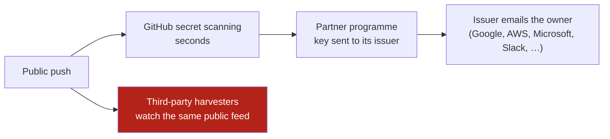

# 05 · Where copies survive, and how to hunt them

Deleting a public repository removes **one** copy. This page lists where others can survive, how to check each one, and which evidence disappears if you act in the wrong order.

---

## How a leak gets noticed (by you and by others)



- GitHub forwards recognised keys in public pushes to the company that issued them. That is why an account owner can receive a "your key was exposed" email from Google, AWS or another provider **minutes after the push**, even when nobody at the company noticed.
- Such an email is **proof** the content was public and readable, and its timestamp is a reliable point for the timeline.
- Attackers' scanners watch the same public feed. Assume they saw everything the partner programme saw.

---

## Where a copy can survive

| Where | What survives | Check with | Can it be removed? |
|---|---|---|---|
| **Clones** on people's machines and bots' storage | Everything | Nothing can see these | No: rotate every secret |
| **Forks** | Full copy. Forks of a public repository **survive** its deletion and the network gets a new root | `list-forks.sh` (while it exists), `hunt-copies.sh` (same-name forks traced to their root) | GitHub DMCA notice, listing every fork |
| **Fork network objects** | If a fork exists, commits from the deleted repository can stay reachable by commit ID through the fork | `find-commit-copies.sh` | GitHub Support (sensitive data removal) |
| **Re-uploads** under another name | Code, often with original history | `find-commit-copies.sh` with original commit IDs | DMCA notice |
| **GH Archive** (permanent public event log) | Commit IDs, messages, author names and emails; **not code** | Query the exposure hours (BigQuery or the hourly files at data.gharchive.org) | No |
| **Wayback Machine** | Pages or raw files someone saved or a crawler visited | `hunt-copies.sh` | Removal request to the Internet Archive |
| **archive.today** | Pages someone saved | By hand in a browser | Contact the service |
| **Software Heritage** | Full archived repositories | `hunt-copies.sh` | Takedown request form |
| **Code search sites** (Sourcegraph, grep.app) | Indexed copies | `hunt-copies.sh` (Sourcegraph); grep.app by hand | Ask the operator |
| **Mirror hosts** (GitLab, Codeberg) | Mirrored or re-uploaded repositories | `hunt-copies.sh` (same-name GitLab projects and accounts) | Their abuse or DMCA process |

```bash
# Everything automatable, one report
./scripts/hunt-copies.sh --since <first-push-date> <owner>/<repo> [<owner>/<repo> ...]

# Renamed copies: search by 2-3 commit IDs from the ORIGINAL repository
./scripts/find-commit-copies.sh --exclude <owner>/<repo> <first-commit-sha> <recent-commit-sha>
```

`hunt-copies.sh` writes `hunts/hunt_<time>/REPORT.md` with every raw response and a checksum manifest. Run it again after a week: a copy published later will not appear in today's report.

---

## Evidence that disappears

Collect these **before** the repository is deleted, or as early as possible.

| Evidence | Who can see it | How long it lasts | Survives deletion? |
|---|---|---|---|
| **Insights → Traffic**: clones, unique cloners, visitors, referrers | Anyone with push access | Rolling **14 days** | **No.** Whether a restored repository gets it back is not documented |
| Repository contents and history | Anyone, while public | Until deleted | No (snapshot it: `snapshot-evidence.sh`) |
| **Account security log**: `repo.create`, `repo.access` (visibility changes), `repo.destroy`, with timestamps | The account owner | Long-term | **Yes**: the best source for the exact exposure window |
| Provider exposure emails | The resource owner | Mailbox retention | Yes |
| GitHub public events API | Anyone | 90 days, max 300 events | Events of deleted repositories drop out |
| GH Archive | Anyone | Permanent | Yes |

**About restoring a deleted repository:** GitHub allows a restore within **90 days**, unless the repository was part of a fork network that is not empty. The documentation does not say whether the restored repository comes back **public or private**, or whether traffic data returns. If you restore one to collect evidence, be ready to make it private immediately.

---

## Removal requests, in order of impact

1. **Rotate secrets first.** No removal un-leaks a key.
2. **The owner deletes** the repository (fastest).
3. **GitHub DMCA notice** for the repository and every fork (`templates/takedown-request.md`).
4. **GitHub Support**: ask for cached views and unreachable commits to be removed.
5. **Archives**: Internet Archive, Software Heritage and others, each through its own request process.
