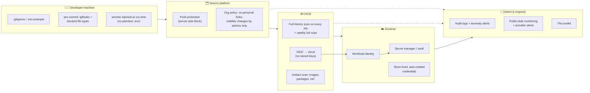
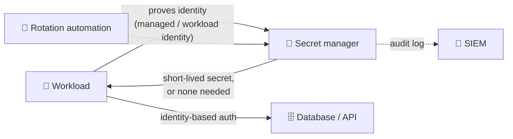

# 08 · Secrets by design: an architecture for never needing this toolkit

The rest of this repository is about responding to a leak. This page is about making leaks **rare, cheap and short-lived**: the controls, the architecture and the rollout plan an architect or platform lead can adopt for a whole organisation.

> [!NOTE]
> **Audience:** architects, platform and DevOps leads, security engineers. Everything here is vendor-neutral; the ready-to-copy files are in [`prevention/`](../prevention/README.md).

---

## 🧭 Five principles

| # | Principle | What it means in practice |
|:-:|---|---|
| 1 | **The best secret is no secret** | Workloads prove *who they are* (managed identity, workload identity federation, IAM roles) instead of presenting a key. A credential that does not exist cannot leak. |
| 2 | **Blast radius × lifetime** | Risk is what a secret can reach multiplied by how long it stays valid. Scope every credential to one service and one environment, and make it expire. |
| 3 | **Advise on the laptop, enforce on the server** | Hooks on developer machines are fast feedback but can be skipped. The source platform and CI are where blocking is guaranteed. |
| 4 | **Assume each layer fails** | Every control is backed by a later one: hook → push protection → CI scan → artifact scan → public-leak monitoring → response. |
| 5 | **Rotatable in minutes** | If rotating a credential needs a change window, a meeting or a person who is on holiday, that is a design flaw to fix before an incident, not during one. |

---

## 🏛️ Reference architecture

---

## 🧱 The control matrix

Each layer has a job in each phase. Gaps in this table are where leaks get through.

| Layer | 🚫 Prevent | 🔎 Detect | 🚑 Respond |
|---|---|---|---|
| **1 · Developer machine** | `.gitignore`, `.env.example`, secrets injected at run time, global ignore file | pre-commit gitleaks + blocked file types | Developer rotates immediately; reports without fear |
| **2 · Repository** | No secrets in code or config; `.gitleaks.toml` with your own token formats | Hook output; `./leak audit` | `./leak scan` on full history |
| **3 · Source platform** | Push protection; no forks to personal accounts; restricted visibility changes; SSO | Secret scanning alerts; audit log of visibility changes | Revoke, remove, takedown (DMCA) |
| **4 · CI/CD** | OIDC instead of stored cloud keys; least-privilege pipeline identities; secrets never echoed | Full-history scan on every PR and weekly | Fail the build; rotate; purge logs |
| **5 · Artifacts** | `.dockerignore`; BuildKit secret mounts; package file allow-lists; encrypted remote IaC state | Image and package secret scans before publish | Delete tag or version; rebuild; rotate |
| **6 · Runtime** | Secret manager + workload identity; short-lived and dynamic credentials; encryption at rest | Secret access audit logs | Automated rotation; revoke sessions |
| **7 · Observability** | Log redaction; no secrets in error messages or traces | Anomaly alerts (new IPs, new regions, spend); canary tokens; public-leak monitoring | `./leak hunt`, [runbook](01-runbook.md) |
| **8 · People** | Clear policy; onboarding; safe-to-report culture | Peer review; reports from staff and outsiders | Practised [drill](07-practice-drill.md); blameless review |

---

## 1 · Developer machine: stop it at the keyboard

**`.env` files.** The single most common leak path. The pattern that works:

| Do | Avoid |
|---|---|
| Commit `.env.example` with **names and placeholders** only ([template](../prevention/env/env.example)) | Committing `.env`, even "temporarily" or on a branch |
| Ignore `.env` and `.env.*` (except examples) in every repo **and** globally: `git config --global core.excludesFile ~/.gitignore-secrets` ([list](../prevention/gitignore-secrets)) | Relying on each repository's `.gitignore` alone |
| Best: have a secret manager **inject variables when the process starts**, so no plaintext file exists | Sharing `.env` files over chat or email |
| Next best: encrypted files in Git (SOPS, git-crypt), decrypted only on authorised machines | Long-lived personal cloud keys in `~/.aws/credentials` |

**Block at commit.** Install the hook once per clone ([pre-commit config](../prevention/pre-commit-config.yaml), or the [plain git hook](../prevention/hooks/pre-commit) with no framework). Both were tested: they block `.env`, private keys and cloud keys, and allow `.env.example` and normal files.

**AI coding assistants.** Assistants read files to build context and can write credentials into code. Keep secrets out of the files they can read, use each tool's ignore file for secret paths, never paste a secret into a prompt, and review generated code for hard-coded keys. GitGuardian reported AI-service credentials leaking **81% more** in 2025 than in 2024 ([report](https://www.gitguardian.com/state-of-secrets-sprawl-report-2026)).

---

## 2 · Repository: make the safe path the easy path

- **Configuration is not a secret store.** Settings files hold names and references (`vault://payments/db`), never values.
- **Teach the scanner your formats.** Internal tokens with a recognisable prefix (`acme_live_…`) are easy to detect; add a rule in [`gitleaks.toml`](../prevention/gitleaks.toml).
- **Keep allow-lists tiny.** Every allow-listed path is a place secrets are not looked for.
- **Score every repository:** `./leak audit <path>` checks ignore rules, tracked secret files, hooks, CI scanning, Docker hygiene and the full history, and gives a grade.

---

## 3 · Source platform: the enforcement point

| Control | Why it matters |
|---|---|
| **Push protection** (GitHub; GitLab secret push protection; Azure DevOps via GitHub Advanced Security) | Blocks known formats **at the server**, so `--no-verify` does not bypass it. In our [measured test](04-prevention.md#-what-each-layer-catches-a-measured-test) it blocked 5 of 9 secret types: a backstop, not the only layer |
| **Secret scanning alerts and partner programmes** | Detect what got through, and let providers revoke their keys |
| **Block forking private repositories to personal accounts** | Removes the most common "copied to someone else's account" path |
| **Only admins change repository visibility** | Prevents "made public by mistake" |
| **SSO and enterprise-managed identities** | Company identities cannot create public personal copies |
| **Audit log streaming** to your SIEM | Visibility changes, bulk clones and new deploy keys raise alerts |

---

## 4 · CI/CD: no stored cloud keys, ever

**Workload identity federation (OIDC).** The pipeline gets a token for about an hour, scoped to one repository and branch or environment. There is no key to store, rotate or leak. Copy-ready jobs for AWS, Azure and Google Cloud: [`prevention/oidc/github-to-clouds.yml`](../prevention/oidc/github-to-clouds.yml). Restrict the trust to the token's `sub` claim (repository plus branch or environment), never to the whole organisation.

**Scan every change, and everything weekly.** Pull requests are scanned over the full history; a weekly scheduled scan catches branches nobody touched. Templates: [GitHub Actions](../prevention/ci/github-actions.yml), [GitLab](../prevention/ci/gitlab-ci.yml), [Azure Pipelines](../prevention/ci/azure-pipelines.yml), [Bitbucket](../prevention/ci/bitbucket-pipelines.yml).

**Logs are output.** Masking only covers registered secrets; values derived from them (encoded, split, printed by tools) are not masked. Never `echo` a secret, avoid `set -x` around secret handling, and treat public CI logs as public.

---

## 5 · Artifacts: images, packages and infrastructure state

| Artifact | Leak path | Control |
|---|---|---|
| **Container images** | `COPY . .` picks up `.env`; `ARG`/`ENV` values stay in image history; deleting a file in a later layer leaves it in the earlier one | [`.dockerignore`](../prevention/docker/dockerignore); BuildKit secret mounts ([example](../prevention/docker/Dockerfile.build-secrets.example)); scan images before pushing |
| **Packages** (npm, PyPI, NuGet, …) | Everything in the folder is published unless excluded | An allow-list of published files; inspect the package before publishing |
| **Terraform / IaC state** | State files store resource attributes, **including secrets, in plain text** | Remote, encrypted, access-controlled state backend; never commit state; mark outputs sensitive; prefer secret references over values |
| **Kubernetes manifests** | `Secret` objects are base64, not encryption | Never commit them; use an external secrets operator or CSI driver, or encrypt for GitOps (Sealed Secrets, SOPS); enable encryption at rest in the cluster |

---

## 6 · Runtime: secret manager plus identity

- **Prefer identity-based authentication to secrets entirely** where the service supports it (cloud databases, storage, queues).
- When a secret is unavoidable, the workload **fetches it at start-up** with its identity, and rotation is automated with an overlap so nothing breaks.
- **Dynamic credentials** (issued per session, expiring in minutes or hours) beat static ones: a leaked dynamic credential is already dead.
- **Environment variables vs files:** environment variables are easy but leak through crash dumps, debug pages and child processes. For high-value secrets prefer files mounted with tight permissions, and never log the environment.

---

## 7 · Observability: notice in minutes, not months

- **Redact at the source:** logging libraries filter known secret fields; error pages never print configuration.
- **Alert on the use of credentials, not only their exposure:** a service identity signing in from a new network, a new region, or spending in a service it never uses.
- **Canary tokens:** fake credentials placed where an attacker would look (old repositories, build servers). Any use is a high-confidence alarm.
- **Public-leak monitoring** for your domains, token formats and developer emails, plus provider exposure emails routed to a monitored mailbox, not one person's inbox.

---

## 8 · People and process

- A one-page policy everyone signs: **company code and secrets never go to personal or public places**, with the safe alternative spelled out.
- Onboarding includes installing the hook; offboarding removes access on the last day.
- **Reporting a mistake is praised, not punished.** The engineer who reports a leaked key in five minutes saves the company hours.
- A rotation owner for every credential, recorded in the secret manager, and a quarterly [drill](07-practice-drill.md).

---

## 📈 Maturity model

| Level | Name | You have | Typical leak outcome |
|:-:|---|---|---|
| 0 | **Ad hoc** | Secrets in code and `.env` files shared by chat | Found by an attacker or a provider email |
| 1 | **Aware** | `.gitignore` rules, a written policy, scanning on some repositories | Found days later; manual rotation |
| 2 | **Guarded** | Hooks for everyone, push protection on, CI full-history scans, `.env.example` everywhere | Blocked before push, or caught within hours |
| 3 | **Managed** | Secret manager for all services, OIDC in all pipelines, owners and rotation runbooks, artifact scanning | Rotation in minutes; small blast radius |
| 4 | **Secretless** | Workload identity by default, dynamic credentials, canaries, anomaly alerts, regular drills | Leaked values are already expired or never existed |

---

## 🗓️ A 90-day rollout

| Phase | Days | Deliver | Done when |
|---|---|---|---|
| **Stop the bleeding** | 1–30 | Push protection org-wide; CI scan template in every active repository; global `.gitignore`; one-page policy | New leaks are blocked at the server or fail CI |
| **Clean house** | 31–60 | Full-history scans of all repositories (`./leak scan`); rotate everything found; hooks in onboarding; `./leak audit` grade B or better on critical repositories | Zero known live secrets in source |
| **Remove the keys** | 61–90 | OIDC for every pipeline; secret manager plus workload identity for production services; rotation owners; first drill | No long-lived cloud keys in CI; every secret has an owner |

---

## 📊 Measure it

| Metric | Target direction | Why |
|---|---|---|
| % of repositories with push protection and CI scanning | → 100% | Coverage of the enforcement layer |
| Secrets caught **before** push vs **after** push | ↑ before | Shows the left-shift is working |
| Median time from detection to revocation | ↓ minutes | The number that decides the damage |
| Long-lived static credentials (count, and age of the oldest) | ↓ | Lifetime is half of the risk |
| % of workloads on workload identity | ↑ | Progress towards secretless |
| `./leak audit` grade across repositories | ↑ A/B | A simple, comparable hygiene score |

---

## ✅ Design-review checklist for a new service

- [ ] Does it authenticate to cloud services with **identity**, not keys?
- [ ] Where a secret is unavoidable: is it in the **secret manager**, fetched at start-up, with a named **owner** and **automated rotation**?
- [ ] Is every credential scoped to **this service and this environment** only?
- [ ] Does the pipeline deploy with **OIDC**, with trust limited to this repository and branch or environment?
- [ ] Does the repository have `.env.example`, ignore rules, the hook, and CI scanning (`./leak audit` grade A or B)?
- [ ] Is IaC state remote, encrypted and access-controlled?
- [ ] Are logs and error pages free of configuration values?
- [ ] Would we notice if one of its credentials were used from somewhere unexpected?
- [ ] Could we rotate every one of its credentials **today, in minutes**, without an outage?
